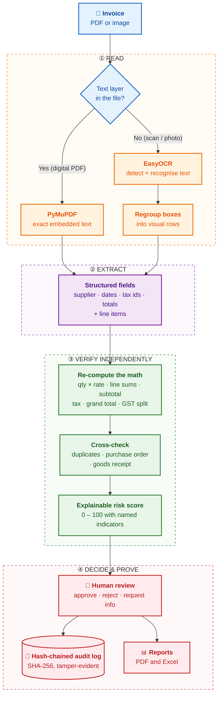

<div align="center">

#  Invoice Anomaly Detection System

### Trust, but verify: every invoice, every number, every decision.

**An invoice-verification engine that reads documents with OCR, re-derives the math independently, reconciles against purchase orders and goods receipts, and records every human decision in a tamper-evident audit trail.**

<br>

[](https://invoice-anomaly-detection-system.streamlit.app/)


</div>

---

Open the app, upload an invoice (PDF or image), and watch it extract, verify, score and explain, with no installation needed. If the app has been idle, it may take a short moment to wake up.

**Suggested 60-second tour:**
1. Upload `sample_01_vat_invoice_clean.pdf` → **Passed Checks**.
2. Upload `sample_03_gst_invoice_errors.pdf` → **High Risk**, with every arithmetic and tax error pinpointed.
3. Upload `sample_04_duplicate_of_01.pdf` → **Exact duplicate** detected.
4. Approve or reject an invoice, then press **Verify** on the audit log to see the hash chain confirmed.

---

## Table of Contents

1. [The Problem](#1-the-problem)
2. [The Solution](#2-the-solution)
3. [How It Works](#3-how-it-works)
4. [OCR Deep Dive](#4-ocr-deep-dive)
5. [Engineering Decisions](#5-engineering-decisions)
6. [Architecture](#6-architecture)
7. [Quick Start](#7-quick-start)
8. [Demo Dataset](#8-demo-dataset)
9. [Quality Assurance](#9-quality-assurance)
10. [Configuration & Security](#10-configuration--security)
11. [Scope & Limitations](#11-scope--limitations)

---

## 1. The Problem

Accounts-payable teams approve payments based on a document that arrives from *outside* the organisation and is, by default, **trusted**. That trust is where the risk lives.

| Failure mode | Why it is hard to catch by eye |
|---|---|
| **Arithmetic and tax errors** | A wrong line total, a subtotal that doesn't add up, or CGST/SGST components that don't sum to the stated tax are easy to miss in a dense document. |
| **Duplicate submissions** | The same invoice re-sent with a tweaked number, a re-scanned copy, or a different file name slips past exact-match checks. |
| **Over-billing** | Quantities or prices that differ from the purchase order, or billing for goods never received, only show up when three documents are compared side by side. |
| **Unreadable inputs** | Invoices arrive as scans and photos. Machines must *read* them first, and reading errors silently corrupt every number that follows. |
| **Opaque approvals** | Ordinary database records can be edited after the fact, so there is no reliable proof of who approved what, and when. |
| **Black-box automation** | Many tools return a confident answer with no explanation, and guess when they cannot read a document. |

The real requirement is not just to *extract* data from an invoice. It is to **independently verify it, explain every finding, and prove the review process was not altered afterwards.**

---

## 2. The Solution

InvoiceShield AI treats every invoice as a **claim to be audited**, not a fact to be ingested.

### System Overview

The diagram below shows the full journey of a single invoice, from upload to a sealed, verifiable decision.



**Four principles guide the design:**

1. **Independent verification.** The system never trusts the totals printed on the invoice. It recomputes quantity × rate, line sums, subtotal, discount, shipping, tax and grand total from scratch.
2. **Explainability over magic.** The risk score is additive and transparent. Every point traces back to a named indicator.
3. **Honesty about uncertainty.** When a layout can't be read reliably, the system reports *Insufficient Evidence* instead of inventing errors or guessing values.
4. **Tamper-evident accountability.** Every reviewer action is cryptographically chained, so any later alteration is detectable.

---

## 3. How It Works

| Stage | Capability |
|---|---|
| **Read** | Text-layer extraction from digital PDFs via PyMuPDF. Scanned PDFs and images are read with EasyOCR. |
| **Extract** | Invoice number, dates, supplier, GSTIN / VAT ID, buyer, PO reference, currency, tax regime, subtotal, discount, shipping, CGST / SGST / IGST, total, and line items. Two parsers cover tabular invoices (column-order aware) and receipt-style `Label: amount` documents. |
| **Validate** | Seven independent checks:<br>• qty × rate = line total<br>• Σ lines = subtotal<br>• subtotal − discount + shipping + tax = total<br>• VAT / GST rate sanity check<br>• CGST + SGST + IGST = total tax<br>• IGST vs. CGST/SGST conflict<br>• missing required fields |
| **Detect duplicates** | Fuzzy matching on invoice number and supplier, plus amount, date, PO reference and file hash. Matches are graded **exact**, **probable** or **similar**. |
| **Reconcile** | Per-item invoice ↔ purchase order (price, quantity, supplier) and invoice ↔ goods receipt note (over-billing detection). |
| **Score risk** | A transparent additive score from 0 to 100, shown with the list of indicators behind it. |
| **Decide** | Approve, reject, or request more information, each with a reviewer comment. |
| **Audit** | Every event stores `SHA-256(previous_hash + event)`. A **Verify** button recomputes the chain and pinpoints the first altered entry. |
| **Report** | One-click per-invoice export to PDF and Excel. |

---

## 4. OCR Deep Dive

OCR is the foundation of this project, and also its most fragile layer. Everything downstream (validation, duplicate detection, reconciliation) is only as reliable as the text it receives. This project is built around that fact.

### 4.1 Two reading paths, chosen automatically

| Input | Method | Why |
|---|---|---|
| Digital PDF with a text layer | **PyMuPDF** reads the embedded text directly | Exact characters, no recognition error. Using OCR here would only add noise. |
| Scanned PDF or image | **EasyOCR** detects text regions and recognises the characters | The only option when no text layer exists. |

### 4.2 The hidden problem: OCR returns *boxes*, not *lines*

OCR engines return a flat list of text fragments, each with a bounding box. They do **not** return the document in reading order. On an invoice, a label and its value often come back as separate, unrelated fragments:

```
 Raw OCR output:      "Invoice No:"     "INV-2041"       (two separate boxes)
 After regrouping:    "Invoice No: INV-2041"              (one visual row)
```

Without a fix, field extraction fails, because a pattern like `Invoice No: <value>` never finds its value. InvoiceShield **regroups OCR boxes spatially into visual rows** before any parsing happens, so the text behaves the way a human sees the page. This single step is what makes label-and-value extraction work on scanned documents.

### 4.3 Table parsing that understands column order

Line items are rarely written as sentences. They sit in columns: description, quantity, rate, amount. The table parser is **column-order aware**, and a separate receipt-style parser handles `Label: amount` layouts such as taxi and retail receipts. Having both means the system adapts to the document's structure instead of forcing one layout on everything.

### 4.4 Handling OCR's characteristic mistakes

OCR does not fail randomly. It fails in *patterns*, and the pipeline is designed around them:

| OCR behaviour | Example | How InvoiceShield responds |
|---|---|---|
| Currency symbol read as a digit | `₹394.40` → `2394.40` | **Conservative repair**: on OCR text only, a stray leading digit is removed *only if doing so makes the invoice reconcile*. The invoice is then marked **Review Required** and the repair is displayed as a finding. |
| Currency symbol missing entirely | no `₹` / `$` detected | If GST is present, currency is set to INR and a note **discloses the inference**. |
| Layout too ambiguous to parse | unusual or damaged scan | Reports **Insufficient Evidence** instead of raising false math errors. |

### 4.5 Why the repair is safe

A guess can be dangerous, so the repair rule is deliberately narrow:

* It runs **only on OCR output**, never on a digital PDF's exact text.
* It acts **only if the corrected number makes the arithmetic reconcile**, so the invoice's own internal consistency acts as proof.
* It is **never silent**: the invoice is flagged for human review and the exact change is shown.

The system uses the invoice's own arithmetic as an error-correcting code, which lets it fix a probable OCR mistake without ever hiding it from the reviewer.

### 4.6 OCR quality is tested against real data

The test suite includes a regression built from the **real OCR output of a taxi receipt** (`tests/fixtures/cab_receipt_ocr_boxes.json`). It originally failed in five ways (wrong supplier, missing date, missing tax, missing line items, wrong amount and currency), and it now guards against those failures returning.

---

## 5. Engineering Decisions

### 🔍 "Insufficient Evidence" instead of guessing
If the layout can't be parsed with confidence, the app says so. A system that knows what it doesn't know is more trustworthy than one that always gives an answer.

### 🛠️ Repairs are conservative and never silent
Every automatic correction is justified by the arithmetic and surfaced to a human reviewer.

### 💱 Inferences are disclosed
When the system fills a gap (such as currency), it tells the reviewer that it did so.

### ✅ "Passed Checks" ≠ "Genuine"
The label means that *no configured rule fired*. It makes no claim that the supplier or invoice is real. The interface and documentation are deliberate about not overstating what automated checks can prove.

### ⛓️ Hash-chained audit log
Each entry commits to the one before it. Editing, deleting or reordering any past record breaks every hash after it, and **Verify** reports exactly where the chain was first altered. This is the same principle that underpins append-only ledgers.

### 🎯 PO / GRN scoring is opt-in
Gaps such as "PO not found" affect the risk score only after at least one PO or GRN has been recorded, so users without reconciliation data aren't penalised.

---

## 6. Architecture

```
InvoiceShield.py     Streamlit UI, SQLite persistence, OCR wiring, reports
invoice_core.py      Pure logic: extraction, validation, duplicates, reconciliation, risk
samples/             Sample invoices + generator
tests/               pytest suite and OCR fixture
```

**Separation of concerns:** all decision logic lives in `invoice_core.py` as pure functions with no UI or database dependencies. That makes the core independently testable and reusable behind a different interface (an API, a batch job or a CLI).

---

## 7. Quick Start

**Fastest:** use the hosted app, **[no installation required →](https://invoice-anomaly-detection-system.streamlit.app/)**

**Run locally:**

```bash
python -m venv .venv && source .venv/bin/activate
pip install -r requirements.txt
streamlit run InvoiceShield.py
```

---

## 8. Demo Dataset

Ready-made samples in `samples/` exercise each behaviour:

| File | Expected result |
|---|---|
| `sample_01_vat_invoice_clean.pdf` | ✅ Passed Checks |
| `sample_02_gst_invoice_clean.pdf` | ✅ Passed Checks (CGST + SGST, HSN column) |
| `sample_03_gst_invoice_errors.pdf` | 🔴 **High Risk**: line math, subtotal, total and GST component errors |
| `sample_04_duplicate_of_01.pdf` | 🟠 **Exact duplicate** of sample 01 (upload 01 first) |
| `sample_05_cab_receipt.pdf` | ✅ Passed Checks (untick *Require PO reference* in the sidebar) |

Regenerate them at any time: `python samples/generate_samples.py`

---

## 9. Quality Assurance

```bash
pip install -r requirements-dev.txt
pytest -q
```

**31 automated tests** cover extraction, validation, duplicate detection, reconciliation and risk scoring, including the real-OCR regression described in [§4.6](#46-ocr-quality-is-tested-against-real-data).

---

## 10. Configuration & Security

| Variable | Purpose |
|---|---|
| `INVOICE_SHIELD_ENCRYPTION_KEY` | Fernet key. When set, uploaded files and stored OCR text are **encrypted at rest**. |
| `INVOICE_SHIELD_DB_PATH` | SQLite file (default `invoiceshield_v5.db`) |
| `INVOICE_SHIELD_UPLOAD_DIR` | Where originals are kept (default `invoiceshield_uploads/`) |
| `INVOICE_SHIELD_MAX_FILE_MB` | Upload limit (default 25) |

Generate a key:

```bash
python -c "from cryptography.fernet import Fernet; print(Fernet.generate_key().decode())"
```

---

## 11. Scope & Limitations

InvoiceShield AI is a **portfolio prototype** built to demonstrate OCR-based document processing and finance controls. It is not a production accounts-payable system. Stating the boundaries plainly is part of the design philosophy.

* **Rule-based extraction.** Parsing is regex- and heuristic-driven and tuned to common invoice layouts. Unusual layouts return *Partial* or *Insufficient Evidence*, which the UI is designed to show clearly.
* **English-only OCR.** Accuracy depends on scan quality, so scanned amounts should always be checked against the source.
* **No authentication or user management.** It is a single-workspace, single-user app intended for local use. If hosted for others, place it behind your own auth (reverse proxy / SSO).
* **SQLite, single workspace.** The schema is tenant-scoped, but there is no tenant-switching UI.
* **Not a guarantee.** It is neither a fraud-detection system nor a tax-compliance guarantee.

### Natural next steps
* Layout-aware or ML-based field extraction to widen supported invoice formats
* Authentication, roles and multi-tenant switching
* REST API on top of `invoice_core.py`
* Multi-language OCR

---

<div align="center">

**Built to answer one question well: *"Can this invoice be trusted, and can we prove how we decided?"***

</div>
